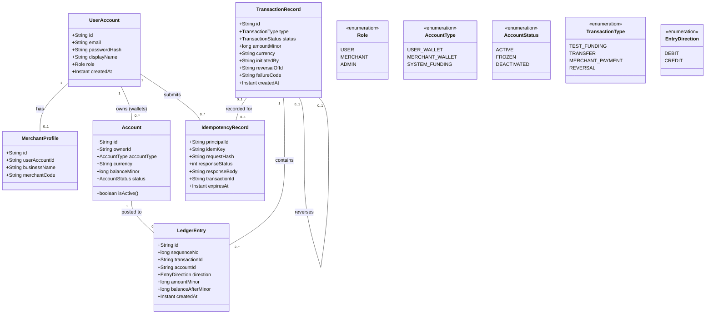
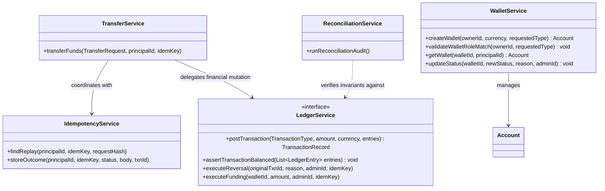

# Component Design and Class Models

## 1. Package Structure

The Spring Boot backend is organized by feature and architectural layer:

```
com.quasar.ledger
├── FinancialLedgerApplication.java
├── common
│   ├── api
│   │   ├── ApiResponse.java
│   │   ├── ErrorResponse.java
│   │   └── ErrorCode.java
│   ├── exception
│   │   ├── ApiException.java
│   │   ├── InsufficientFundsException.java
│   │   ├── IdempotencyException.java
│   │   ├── ServiceBusyException.java
│   │   └── GlobalExceptionHandler.java
│   └── util
│       ├── MoneyUtils.java            // Exact string <-> paise conversions
│       └── HashUtils.java             // SHA-256 fingerprint generator
├── config
│   ├── DatabaseConfig.java            // SQLite WAL mode, foreign keys, busy timeout
│   ├── SecurityConfig.java            // JWT filter chain, role-based endpoint mapping
│   └── OpenApiConfig.java             // Swagger / OpenAPI documentation
├── module
│   ├── auth
│   │   ├── controller.AuthController
│   │   ├── model.UserAccount
│   │   ├── model.MerchantProfile
│   │   ├── model.Role (USER, MERCHANT, ADMIN)
│   │   ├── repository.AccountRepository
│   │   └── service.AuthService
│   ├── wallet
│   │   ├── controller.WalletController
│   │   ├── model.Account (USER_WALLET, MERCHANT_WALLET, SYSTEM_FUNDING)
│   │   ├── model.AccountStatus (ACTIVE, FROZEN, DEACTIVATED)
│   │   ├── repository.WalletRepository
│   │   └── service.WalletService
│   ├── transfer
│   │   ├── controller.TransferController
│   │   ├── controller.PaymentController
│   │   ├── dto.TransferRequest
│   │   ├── dto.PaymentRequest
│   │   └── service.TransferService
│   ├── idempotency
│   │   ├── model.IdempotencyRecord
│   │   ├── repository.IdempotencyRepository
│   │   └── service.IdempotencyService
│   ├── ledger
│   │   ├── model.TransactionRecord
│   │   ├── model.TransactionType (TEST_FUNDING, TRANSFER, MERCHANT_PAYMENT, REVERSAL)
│   │   ├── model.TransactionStatus (COMPLETED, FAILED)
│   │   ├── model.LedgerEntry
│   │   ├── model.EntryDirection (DEBIT, CREDIT)
│   │   ├── repository.TransactionRepository
│   │   ├── repository.LedgerEntryRepository
│   │   └── service.LedgerService      // Sole writer interface
│   ├── reconciliation
│   │   ├── controller.ReconciliationController
│   │   ├── dto.ReconciliationReport
│   │   └── service.ReconciliationService
│   └── admin
│       ├── controller.AdminController
│       └── service.AdminService
```

## 2. Core Domain Class Diagram



## 3. Service Layer Collaboration Diagram


