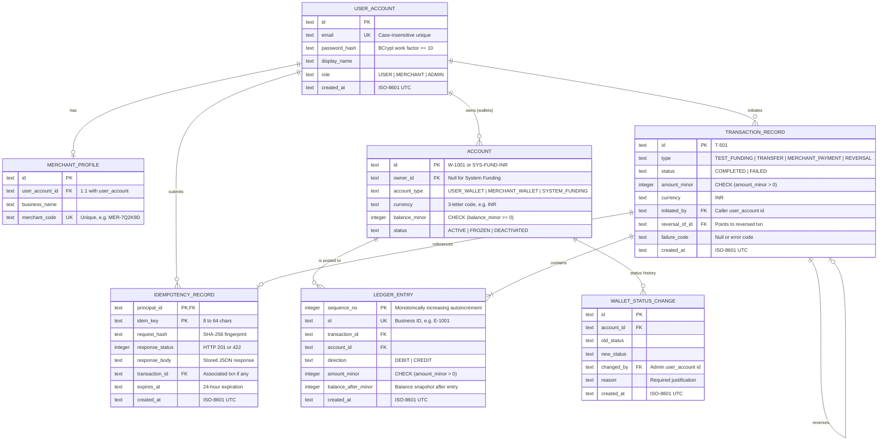

# Database Schema and Entity-Relationship Design

## 1. Relational Entity-Relationship Diagram



## 2. Table Definitions and DDL Specification

Below is the complete, production-grade SQLite schema strictly honoring SRS Section 6.1 (Database Requirements `DB-01` to `DB-06`).

```sql
-- Enforce foreign keys and WAL mode
PRAGMA foreign_keys = ON;

-- 1. User Account Table
CREATE TABLE IF NOT EXISTS user_account (
    id            TEXT PRIMARY KEY,
    email         TEXT NOT NULL COLLATE NOCASE,
    password_hash TEXT NOT NULL,
    display_name  TEXT NOT NULL,
    role          TEXT NOT NULL CHECK (role IN ('USER', 'MERCHANT', 'ADMIN')),
    created_at    TEXT NOT NULL,
    CONSTRAINT uk_user_email UNIQUE (email)
);

-- 2. Merchant Profile Table
CREATE TABLE IF NOT EXISTS merchant_profile (
    id              TEXT PRIMARY KEY,
    user_account_id TEXT NOT NULL,
    business_name   TEXT NOT NULL,
    merchant_code   TEXT NOT NULL,
    CONSTRAINT uk_merchant_user UNIQUE (user_account_id),
    CONSTRAINT uk_merchant_code UNIQUE (merchant_code),
    FOREIGN KEY (user_account_id) REFERENCES user_account(id) ON DELETE RESTRICT
);

-- 3. Account Table (Wallets and System Funding Accounts)
CREATE TABLE IF NOT EXISTS account (
    id            TEXT PRIMARY KEY,
    owner_id      TEXT,
    account_type  TEXT NOT NULL CHECK (account_type IN ('USER_WALLET', 'MERCHANT_WALLET', 'SYSTEM_FUNDING')),
    currency      TEXT NOT NULL,
    balance_minor INTEGER NOT NULL DEFAULT 0 CHECK (balance_minor >= 0),
    status        TEXT NOT NULL CHECK (status IN ('ACTIVE', 'FROZEN', 'DEACTIVATED')),
    CONSTRAINT uk_owner_currency UNIQUE (owner_id, currency),
    FOREIGN KEY (owner_id) REFERENCES user_account(id) ON DELETE RESTRICT,
    -- Strictly enforce role and ownership constraints:
    -- System funding accounts must have owner_id NULL
    -- User and merchant wallets must have a non-null owner_id
    CONSTRAINT chk_account_ownership CHECK (
        (account_type = 'SYSTEM_FUNDING' AND owner_id IS NULL) OR
        (account_type IN ('USER_WALLET', 'MERCHANT_WALLET') AND owner_id IS NOT NULL)
    )
);

-- 4. Transaction Record Table
CREATE TABLE IF NOT EXISTS transaction_record (
    id             TEXT PRIMARY KEY,
    type           TEXT NOT NULL CHECK (type IN ('TEST_FUNDING', 'TRANSFER', 'MERCHANT_PAYMENT', 'REVERSAL')),
    status         TEXT NOT NULL CHECK (status IN ('COMPLETED', 'FAILED')),
    amount_minor   INTEGER NOT NULL CHECK (amount_minor > 0),
    currency       TEXT NOT NULL,
    initiated_by   TEXT NOT NULL,
    reversal_of_id TEXT,
    failure_code   TEXT,
    created_at     TEXT NOT NULL,
    FOREIGN KEY (initiated_by) REFERENCES user_account(id) ON DELETE RESTRICT,
    FOREIGN KEY (reversal_of_id) REFERENCES transaction_record(id) ON DELETE RESTRICT
);

-- 5. Ledger Entry Table
CREATE TABLE IF NOT EXISTS ledger_entry (
    sequence_no         INTEGER PRIMARY KEY AUTOINCREMENT,
    id                  TEXT NOT NULL,
    transaction_id      TEXT NOT NULL,
    account_id          TEXT NOT NULL,
    direction           TEXT NOT NULL CHECK (direction IN ('DEBIT', 'CREDIT')),
    amount_minor        INTEGER NOT NULL CHECK (amount_minor > 0),
    balance_after_minor INTEGER NOT NULL,
    created_at          TEXT NOT NULL,
    CONSTRAINT uk_ledger_entry_id UNIQUE (id),
    FOREIGN KEY (transaction_id) REFERENCES transaction_record(id) ON DELETE RESTRICT,
    FOREIGN KEY (account_id) REFERENCES account(id) ON DELETE RESTRICT
);

-- 6. Idempotency Record Table
CREATE TABLE IF NOT EXISTS idempotency_record (
    principal_id    TEXT NOT NULL,
    idem_key        TEXT NOT NULL,
    request_hash    TEXT NOT NULL,
    response_status INTEGER NOT NULL,
    response_body   TEXT NOT NULL,
    transaction_id  TEXT,
    expires_at      TEXT NOT NULL,
    created_at      TEXT NOT NULL,
    PRIMARY KEY (principal_id, idem_key),
    FOREIGN KEY (principal_id) REFERENCES user_account(id) ON DELETE CASCADE,
    FOREIGN KEY (transaction_id) REFERENCES transaction_record(id) ON DELETE SET NULL
);

-- 7. Wallet Status Change Audit Log
CREATE TABLE IF NOT EXISTS wallet_status_change (
    id         TEXT PRIMARY KEY,
    account_id TEXT NOT NULL,
    old_status TEXT NOT NULL,
    new_status TEXT NOT NULL,
    changed_by TEXT NOT NULL,
    reason     TEXT NOT NULL,
    created_at TEXT NOT NULL,
    FOREIGN KEY (account_id) REFERENCES account(id) ON DELETE RESTRICT,
    FOREIGN KEY (changed_by) REFERENCES user_account(id) ON DELETE RESTRICT
);

-- 8. Indexes for Query Performance
CREATE INDEX IF NOT EXISTS idx_ledger_account_time ON ledger_entry(account_id, created_at);
CREATE INDEX IF NOT EXISTS idx_ledger_txn ON ledger_entry(transaction_id);
CREATE INDEX IF NOT EXISTS idx_txn_initiated ON transaction_record(initiated_by, created_at);
CREATE INDEX IF NOT EXISTS idx_idem_expires ON idempotency_record(expires_at);

-- 9. Immutability & Ledger Invariant Triggers (DB-06, FR-LED-01 & NFR-SAFE-06)
-- Committed ledger entries, transaction records, and wallet status changes are strictly immutable.
CREATE TRIGGER IF NOT EXISTS prevent_ledger_entry_update
BEFORE UPDATE ON ledger_entry
BEGIN
    SELECT RAISE(ABORT, 'ILLEGAL_OPERATION: Ledger entries are immutable and cannot be updated');
END;

CREATE TRIGGER IF NOT EXISTS prevent_ledger_entry_delete
BEFORE DELETE ON ledger_entry
BEGIN
    SELECT RAISE(ABORT, 'ILLEGAL_OPERATION: Ledger entries cannot be deleted');
END;

CREATE TRIGGER IF NOT EXISTS prevent_transaction_update
BEFORE UPDATE ON transaction_record
BEGIN
    SELECT RAISE(ABORT, 'ILLEGAL_OPERATION: Transactions are immutable and cannot be updated');
END;

CREATE TRIGGER IF NOT EXISTS prevent_transaction_delete
BEFORE DELETE ON transaction_record
BEGIN
    SELECT RAISE(ABORT, 'ILLEGAL_OPERATION: Transactions cannot be deleted');
END;

CREATE TRIGGER IF NOT EXISTS prevent_status_change_update
BEFORE UPDATE ON wallet_status_change
BEGIN
    SELECT RAISE(ABORT, 'ILLEGAL_OPERATION: Wallet status change audit records are immutable and cannot be updated');
END;

CREATE TRIGGER IF NOT EXISTS prevent_status_change_delete
BEFORE DELETE ON wallet_status_change
BEGIN
    SELECT RAISE(ABORT, 'ILLEGAL_OPERATION: Wallet status change audit records cannot be deleted');
END;

-- Invariant Enforcement: Reject any attempt to insert a ledger entry for a FAILED transaction (FR-LED-01)
CREATE TRIGGER IF NOT EXISTS prevent_failed_transaction_entries
BEFORE INSERT ON ledger_entry
FOR EACH ROW
WHEN (SELECT status FROM transaction_record WHERE id = NEW.transaction_id) = 'FAILED'
BEGIN
    SELECT RAISE(ABORT, 'ILLEGAL_OPERATION: FAILED transactions must have zero ledger entries (FR-LED-01)');
END;
```

## 3. Database Constraints and Retention Policy Summary

### Constraints
| Table | Constraint | Purpose |
|---|---|---|
| `account` | `CHECK (balance_minor >= 0)` | Mathematical guarantee that wallet balances never go negative (`BR-05`). |
| `account` | `UNIQUE (owner_id, currency)` | Strictly limits owners to at most one wallet per currency (`FR-WAL-03`). |
| `account` | `chk_account_ownership` | Enforces account separation: `SYSTEM_FUNDING` must have `owner_id IS NULL`; `USER_WALLET` / `MERCHANT_WALLET` must have valid `owner_id` (`ACC-01`, `FR-WAL-01`, `FR-WAL-02`). |
| `ledger_entry` | `INTEGER PRIMARY KEY AUTOINCREMENT` on `sequence_no` | Strict monotonic sequence ordering with single valid SQLite primary key; `id` separately UNIQUE. |
| `ledger_entry` | `CHECK (amount_minor > 0)` | Rejects zero or negative amounts (`DB-03`). |
| `transaction_record` | `CHECK (amount_minor > 0)` | Rejects negative transaction attempts (`DB-03`). |
| `idempotency_record` | `PRIMARY KEY (principal_id, idem_key)` | Scopes idempotency keys to individual callers (`FR-TRF-02`). |
| Triggers | `BEFORE UPDATE / DELETE` on `ledger_entry`, `transaction_record`, `wallet_status_change` | Enforces WORM (Write Once, Read Many) immutability at the database engine level (`DB-06`, `NFR-SAFE-06`). |

### Retention Policy (DB-05)
- **Indefinite Retention**: In accordance with `DB-05` and `FR-4`, all records in `ledger_entry`, `transaction_record`, and `wallet_status_change` are retained indefinitely for complete historical and financial auditability.
- **Time-Bounded Pruning**: In accordance with `DB-05` and `FR-TRF-04`, `idempotency_record` entries are retained for a minimum of 24 hours to handle delayed network retries, after which expired records (`expires_at < current_time`) may be pruned by background cleanup jobs without affecting ledger integrity.

## 4. Stage 3 changes to the design (implemented in `src/main/resources/schema.sql`)

The schema was implemented as designed, with these additions (marked `[S3]` in `schema.sql`):

| Change | Why |
|---|---|
| `account.created_at` | wallets are listed and shown with their creation time (FR-WAL-06, FR-ADM-02) |
| `transaction_record.source_account_id`, `destination_account_id` | a FAILED transaction has no ledger entries, so without these columns it could not be shown in the initiator's history (FR-LED-11, FR-TRF-13) |
| `transaction_record.description` | transfer description (140), payment reference (64), reversal reason (FR-TRF-01, FR-PAY-01, FR-LED-08) |
| `CHECK ((status = 'FAILED') = (failure_code IS NOT NULL))` and `CHECK ((type = 'REVERSAL') = (reversal_of_id IS NOT NULL))` | the database rejects inconsistent rows |
| `UNIQUE INDEX uq_txn_reversal_of ON transaction_record(reversal_of_id)` | BR-10 "reversed once" enforced by the database, not only by code |
| `typeof(x) = 'integer'` in every money CHECK | SQLite would otherwise store 10.5 in an INTEGER column; this enforces DB-03 / TQ-6 at the storage level |
| `idempotency_record.response_status IN (201, 422)` | FR-TRF-08: only these outcomes are stored |
| `reconciliation_run` table | log of reconciliation runs for "latest reconciliation result" (FR-ADM-07); not financial data |
| The old `DB-06` label in section 3 | refers to the immutability triggers; the SRS numbers them under FR-LED-05 / NFR-SAFE-06 |

The PRAGMAs are applied per connection by `DatabaseConfig` (WAL, `foreign_keys=ON`, `synchronous=FULL`, `busy_timeout`); `DatabaseConfigurationTest` verifies them. Write transactions start with `BEGIN IMMEDIATE` (ADR-009).
