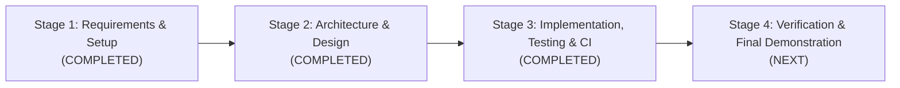

# Development Plan and Task Breakdown

## 1. Project Stages Overview

Following the course SDLC and SRS v1.2 (the version in the repository; earlier documents said "v1.4" by mistake), the project is structured into four sequential stages:

## 2. Stage Breakdown and Detailed Task Planning

### Stage 1: Requirements & Second Brain Setup (Completed)
- [x] SRS document baseline v1.4 ([Financial_Wallet_Ledger_SRS (2) (1).docx](file:///c:/college/sem5/Financial_Ledger_Team_QUASAR/Financial_Wallet_Ledger_SRS%20(2)%20(1).docx)).
- [x] Obsidian vault PARA structure (`inbox/`, `projects/`, `areas/`, `resources/`, `archive/`).
- [x] Ingestion of initial research notes into `brain/inbox/`.
- [x] Initial `AGENTS.md` and repository skeleton (Java 17, Spring Boot 3, SQLite JDBC).
- [x] Initial CI pipeline for build, test, skills, brain notes, and secret scanning.

---

### Stage 2: Architecture, Database Design & Second Brain Skills (Completed)
- [x] **Task 2.1: Second Brain Workflow Skills**:
  - Implement `brain-refine` skill (`brain/skills/brain-refine/SKILL.md`).
  - Implement `brain-query` skill (`brain/skills/brain-query/SKILL.md`).
  - Implement initial `local-check` skill (`brain/skills/local-check/SKILL.md`).
- [x] **Task 2.2: Note Distillation**:
  - Distill raw `inbox/` notes into authoritative reference guides in `brain/resources/`.
- [x] **Task 2.3: Architecture Decision Records (ADRs)**:
  - Document ADR-001 through ADR-007 in `docs/adr/`, citing distilled notes.
- [x] **Task 2.4: System Architecture & UML Modeling**:
  - Modular monolith architecture, sequence flows, component models, and service collaboration in `docs/architecture/`.
- [x] **Task 2.5: Database & ER Design**:
  - Entity-relationship model, DDL scripts, indexes, check constraints, and immutability triggers.
- [x] **Task 2.6: Traceability Matrix & Development Plan**:
  - End-to-end matrix mapping requirements to design, tests, skills, and brain notes.

---

### Stage 3: Core Implementation, Testing & CI (Completed)

Work is split by functional area (one member each) and merged M1 -> M2 -> M3. A box is ticked only when the work is merged to `main` with a reviewed, green PR.

| Task | Owner | Issue | Built and tested locally | Merged |
|---|---|---|---|---|
| 3.1 Data access, SQLite WAL configuration, schema + triggers, `BEGIN IMMEDIATE` manager | Akshaya (platform), Geethika (ADR-009) | #5, #12 | yes | [x] #23, #24 |
| 3.2a `auth`, `wallet`, admin directory, health, security | Akshaya | #5 | yes | [x] #23 |
| 3.2b `ledger`, `idempotency`, funding, reversals, `reconciliation`, admin ledger views | Geethika | #9, #10 | yes | [x] #24 |
| 3.2c `transfer`: transfers, payments, merchant views, history | Suhasini | #13 | yes | [x] #25, #26 |
| 3.3 Automated tests TQ-1..TQ-6 (153 tests, 96.5% line coverage) | all three, per module | #5, #9, #13, #14 | yes | [x] #23, #24, #25, #26 |
| 3.4 `simulate-transfer` skill + evaluations | Suhasini | #15 | yes | [x] #25 |
| 3.5 `local-check` skill + evaluations | Akshaya | #6 | yes | [x] #23 |
| 3.6 CI: build, lint, tests, secrets (Akshaya); brain validation (Geethika); skill validation (Suhasini) | all three | #7, #11, #16 | yes (and green on every PR) | [x] #23, #24, #25 |
| 3.7 Brain refine, notes by every member, stage review notes | all three | #8, #11, #17 | yes | [x] #23, #24, #25, #28 |
| 3.8 Test plan (Geethika), test report, defect log, traceability, CHANGELOG (Suhasini) | Geethika, Suhasini | #12, #17 | yes | [x] #24, #25, #26, #27, #28 |
| 3.9 Release tag `v0.3.0-stage3` | Suhasini | #17 | - | [x] tagged on the merge of the release PR |

---

### Stage 4: Frontend, Verification & Review (Final Stage)

Detailed plan, owners, PR order and acceptance criteria: `docs/stage-4/MASTER_PLAN.md` (proposal, needs team approval).

- [ ] **Task 4.1: Minimal React Web Interface**:
  - User Dashboard, Transfer screen, Merchant Payment screen.
  - Merchant transaction views and statistics.
  - Admin wallet management, test funding, and reconciliation interface.
- [ ] **Task 4.2: End-to-End Live Demonstrations**:
  - Live execution of `simulate-transfer`, `local-check`, and `brain-query`.
  - Walkthrough from requirement to brain note, ADR, code, and passing test.
  - Final release tagging and documentation review.

## 3. Team Responsibilities Matrix

### Stage 3 (functional areas)

| Team Member | Functional area | Shared responsibilities |
|---|---|---|
| **Akshaya A** [BT2024215] | Accounts, wallets, admin directory, health, security, platform configuration | `local-check` skill, Checkstyle lint + CI core jobs, README / user guide, ADR-008, reviews M2's PR |
| **Geethika M** [BT2024139] | Ledger engine, idempotency, test funding, reversals, reconciliation, admin ledger views | brain refine + brain validation in CI, test plan, ADR-009, reviews M3's PR |
| **Suhasini M** [BT2024043] | Transfers, merchant payments, merchant views, transaction history, concurrency/durability/performance tests | `simulate-transfer` skill, skill validation in CI, traceability, test report, defect log, CHANGELOG, release; reviews M1's PR |

### Stage 2

| Team Member | Core Focus & Responsibilities | Stage 2 Deliverables |
|---|---|---|
| **Akshaya A** [BT2024215] | System Architecture, ADRs, Second Brain Workflow Skills, Database Design | System Architecture, ADR-001 to ADR-007, `brain-refine`, `brain-query`, `local-check`, Database Schema, Traceability Matrix |
| **Suhasini M** [BT2024043] | Concurrency, SQLite WAL Integration, Admin & Ledger Core | Concurrency Research, Lock Serialization Architecture, Git Repository Management |
| **Geethika M** [BT2024139] | Double-Entry Bookkeeping, Reconciliation Engine, API Security | Accounting Models, Reconciliation Algorithms, Security Specifications |
