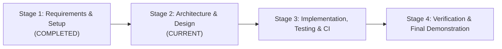

# Development Plan and Task Breakdown

## 1. Project Stages Overview

Following the course SDLC and SRS v1.4, the project is structured into four sequential stages:

## 2. Stage Breakdown and Detailed Task Planning

### Stage 1: Requirements & Second Brain Setup (Completed)
- [x] SRS document baseline v1.4 ([Financial_Wallet_Ledger_SRS (2) (1).docx](file:///c:/college/sem5/Financial_Ledger_Team_QUASAR/Financial_Wallet_Ledger_SRS%20(2)%20(1).docx)).
- [x] Obsidian vault PARA structure (`inbox/`, `projects/`, `areas/`, `resources/`, `archive/`).
- [x] Ingestion of initial research notes into `brain/inbox/`.
- [x] Initial `AGENTS.md` and repository skeleton (Java 17, Spring Boot 3, SQLite JDBC).
- [x] Initial CI pipeline for build, test, skills, brain notes, and secret scanning.

---

### Stage 2: Architecture, Database Design & Second Brain Skills (Current Deliverable)
- [x] **Task 2.1: Second Brain Workflow Skills**:
  - Implement `brain-refine` skill (`brain/skills/brain-refine/SKILL.md`).
  - Implement `brain-query` skill (`brain/skills/brain-query/SKILL.md`).
  - Implement initial `local-check` skill (`brain/skills/local-check/SKILL.md`).
- [x] **Task 2.2: Note Distillation**:
  - Distill raw `inbox/` notes into authoritative reference guides in `brain/resources/`.
- [x] **Task 2.3: Architecture Decision Records (ADRs)**:
  - Document ADR-001 through ADR-007 in `docs/adr/`, citing distilled notes.
- [x] **Task 2.4: System Architecture & UML Modeling**:
  - Modular monolith architecture, sequence flows, component models, and service collaboration in `docs/architecture/`.
- [x] **Task 2.5: Database & ER Design**:
  - Entity-relationship model, DDL scripts, indexes, check constraints, and immutability triggers.
- [x] **Task 2.6: Traceability Matrix & Development Plan**:
  - End-to-end matrix mapping requirements to design, tests, skills, and brain notes.

---

### Stage 3: Core Implementation, Testing & CI (Upcoming)
- [ ] **Task 3.1: Data Access Layer & SQLite Configuration**:
  - Spring JDBC repositories, schema initializer, WAL mode configuration, and immutability triggers.
- [ ] **Task 3.2: Domain Module Implementation**:
  - `auth`: Registration, BCrypt password hashing, and JWT provider.
  - `wallet`: Wallet creation, retrieval, and status changes.
  - `ledger`: Double-entry transaction engine (Sole Writer).
  - `transfer`: Same-currency P2P transfers and merchant payments.
  - `idempotency`: SHA-256 fingerprinting and response replay filter.
  - `reconciliation`: Three-point snapshot audit engine.
  - `admin`: Platform statistics, test funding, and reversals.
- [ ] **Task 3.3: Automated Test Suite (TQ-1 to TQ-6)**:
  - Accounting unit tests (debit/credit balance checks, hash validation).
  - Transaction rollback integration tests (simulated database failure points).
  - Concurrency & race condition tests (simultaneous transfers).
  - Negative tests (overdrafts, invalid payloads, malformed IDs).
- [ ] **Task 3.4: Product-Specific Skill (`simulate-transfer`)**:
  - Automated product verification workflow.

---

### Stage 4: Frontend, Verification & Review (Final Stage)
- [ ] **Task 4.1: Minimal React Web Interface**:
  - User Dashboard, Transfer screen, Merchant Payment screen.
  - Merchant transaction views and statistics.
  - Admin wallet management, test funding, and reconciliation interface.
- [ ] **Task 4.2: End-to-End Live Demonstrations**:
  - Live execution of `simulate-transfer`, `local-check`, and `brain-query`.
  - Walkthrough from requirement to brain note, ADR, code, and passing test.
  - Final release tagging and documentation review.

## 3. Team Responsibilities Matrix

| Team Member | Core Focus & Responsibilities | Stage 2 Deliverables |
|---|---|---|
| **Akshaya A** [BT2024215] | System Architecture, ADRs, Second Brain Workflow Skills, Database Design | System Architecture, ADR-001 to ADR-007, `brain-refine`, `brain-query`, `local-check`, Database Schema, Traceability Matrix |
| **Suhasini M** [BT2024043] | Concurrency, SQLite WAL Integration, Admin & Ledger Core | Concurrency Research, Lock Serialization Architecture, Git Repository Management |
| **Geethika M** [BT2024139] | Double-Entry Bookkeeping, Reconciliation Engine, API Security | Accounting Models, Reconciliation Algorithms, Security Specifications |
