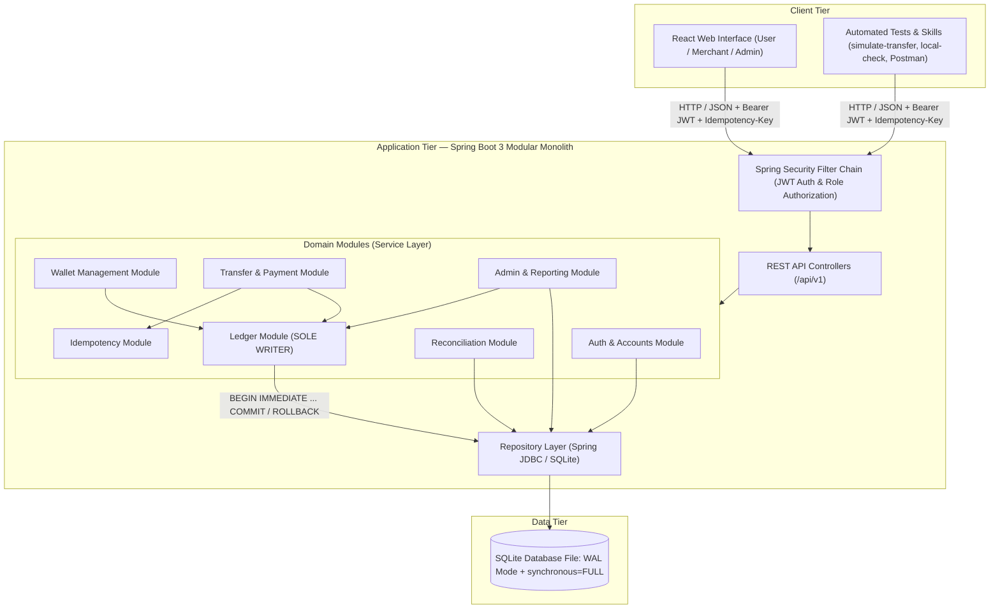
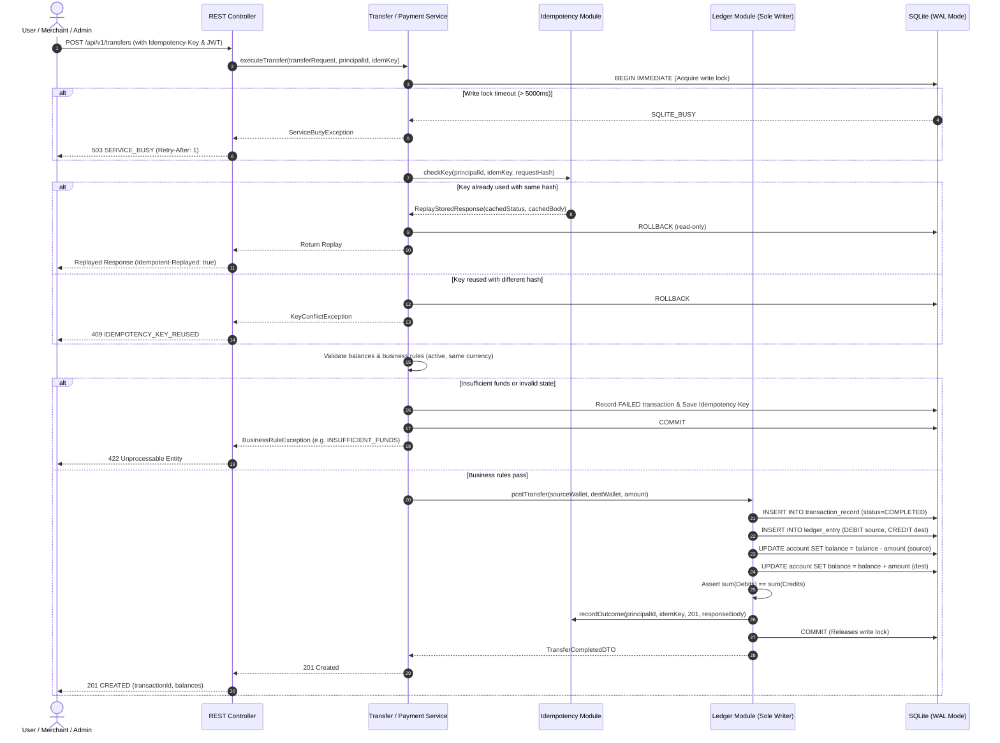

# System Architecture and Component Design

## 1. System Overview and Perspective

The Financial Ledger system is designed as a **Modular Monolith** running as a single Java 17 Spring Boot 3 process that exclusively owns a local SQLite database file operating in Write-Ahead Logging (WAL) mode. Clients connect over HTTP/1.1 with JSON payloads.



## 2. Module Boundaries and Responsibilities

Following requirement `NFR-MAIN-01` and `NFR-MAIN-02`, the architecture is structured into layered modules with unidirectional dependencies:

| Module | Primary Interface / Class | Responsibilities & Invariants |
|---|---|---|
| **`auth`** | `AuthService`, `JwtTokenProvider` | Handles registration, credential validation with BCrypt, merchant code generation, and signed JWT issuance. |
| **`wallet`** | `WalletService` | Manages wallet creation (one per owner per currency), balance reading, and administrative status transitions (`ACTIVE`, `FROZEN`, `DEACTIVATED`). |
| **`transfer`** | `TransferService`, `PaymentService` | Validates input bounds, enforces same-currency rules, verifies wallet active status, and coordinates transfers and merchant payments. |
| **`idempotency`**| `IdempotencyService` | Computes SHA-256 payload hashes, retrieves stored responses for replays, and persists idempotency records within financial transactions. |
| **`ledger`** | `LedgerService` | **The Single Source of Truth**. Sole writer of ledger entries and cached wallet balances. Enforces $\sum \text{Debits} = \sum \text{Credits}$ before committing. |
| **`reconciliation`**| `ReconciliationService`| Executes read-only point-in-time audits: verifies C1 (currency totals), C2 (transaction internal balance), and C3 (account balance derivation). |
| **`admin`** | `AdminService` | Admin dashboard statistics, system funding, and transaction reversals. |

## 3. Financial Transaction Lifecycle Flow

All balance mutations run inside a single SQLite transaction with `BEGIN IMMEDIATE` to guarantee race safety.



## 4. Reconciliation Engine Flow

```mermaid
sequenceDiagram
    autonumber
    actor Admin as Admin Client
    participant ReconCtrl as ReconciliationController
    participant ReconService as ReconciliationService
    participant DB as SQLite (WAL Mode)

    Admin->>ReconCtrl: POST /api/v1/admin/reconciliations
    ReconCtrl->>ReconService: runReconciliation()
    ReconService->>DB: BEGIN (Read-only Snapshot)
    Note over ReconService,DB: Reads consistent WAL snapshot without blocking active writers
    ReconService->>DB: Check C1: SELECT currency, sum(debit), sum(credit) FROM ledger_entry GROUP BY currency
    ReconService->>DB: Check C2: SELECT transaction_id, sum(debit), sum(credit), count(*) FROM ledger_entry GROUP BY transaction_id
    ReconService->>DB: Check C3: Compare cached balance in account table with calculated ledger sums (credits - debits for Wallets; debits - credits for System Funding)
    ReconService->>DB: COMMIT (End Read Transaction)
    Note over ReconService: Zero mutation; pure read audit
    alt All checks match exactly
        ReconService-->>ReconCtrl: ReconciliationReport(status=PASS, discrepancies=[])
        ReconCtrl-->>Admin: 200 OK (Report: PASS)
    else Any mismatch detected
        ReconService-->>ReconCtrl: ReconciliationReport(status=FAIL, discrepancies=[...])
        ReconCtrl-->>Admin: 200 OK (Report: FAIL with detailed diffs)
    end
```
